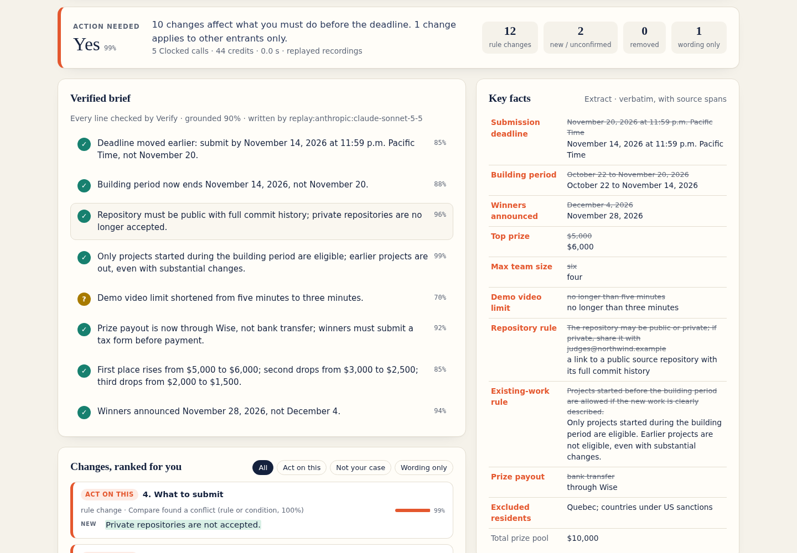

# Rule Change Radar

**Contest rules change after you sign up. Rule Change Radar tells you what changed, which changes matter
for *you*, and checks every line of its own summary against the source before showing it.**

Paste two versions of a hackathon's (or any contest's) official rules, or point the watcher at a rules URL.
You get:

- **A verified brief**: a short list of what changed, written by a model you choose. Every line goes through
  Clocked **Verify**, which checks it against both versions. Lines the sources contradict are taken out of the
  brief and shown with the passage that disproves them.
- **Changes ranked for your situation**: Clocked **Rerank** reads each change with your profile (country,
  team size, start date, repository, video length). Each change is labelled *Act on this*, *Read the section*,
  *Low impact* or *Not your case*. For example, a new Quebec exclusion is *Not your case* for an entrant in Taiwan.
- **Real changes kept apart from rewording**: Clocked **Compare** reads both versions. It separates real
  conflicts (a moved deadline, a new limit) from sentences that say the same thing in new words.
- **Key facts with source spans**: Clocked **Extract** copies the deadline, prizes, team limit, video limit and
  repository rule from each version, word for word. Click a fact to see where it sits in the source text.
- **A rumour checker**: paste what someone said on Discord ("the deadline was extended") and Verify answers
  *supported*, *contradicted* or *not stated*, quoting the passage it used. Up to 20 claims at a time,
  one Verify request each.

Who it is for: hackathon entrants, and anyone else who has to follow rules that change, such as grant
applicants, sellers on a marketplace or vendors on a tender. They read the rules once, at sign-up, and miss
the update that moved the deadline or banned private repositories.



## Quick start (no key needed)

Requires Python 3.10+. Nothing else: the app uses the standard library only.

```bash
git clone https://github.com/mubudot/clocked-rule-radar && cd clocked-rule-radar
python -m rule_radar serve          # open http://127.0.0.1:8765/  and click "Scan for changes"
```

Without a `CLOCKED_API_KEY`, the app runs in **replay mode**. It serves real Clocked responses that were
recorded for the bundled sample (`fixtures/replay/`), including the Claude-written brief. So the whole flow
works offline: scan, verified brief, ranking, key facts, and the four rumour chips.

Terminal version:

```bash
python -m rule_radar analyze samples/northwind_v1.md samples/northwind_v2.md \
       --profile samples/profile_solo_taiwan.json      # exit code 3 = changes that concern you
python -m rule_radar check samples/northwind_v1.md samples/northwind_v2.md \
       "The total prize pool grew to \$12,000."
```

## Live mode (your own text)

1. Create a free account at <https://clocked.rezolve.ai/account> and create an API key.
2. `cp .env.example .env` and set `CLOCKED_API_KEY=...`. You can also export it in your shell.
3. Choose the model that writes the brief. Both API formats work:

| Provider | Settings |
| --- | --- |
| none (template brief) | `RADAR_LLM_PROVIDER=offline` (default) |
| OpenAI-compatible (`/chat/completions`): OpenAI, OpenRouter, vLLM, Ollama, LM Studio | `RADAR_LLM_PROVIDER=openai`, `RADAR_LLM_MODEL=gpt-4o-mini`, optional `RADAR_LLM_BASE_URL=http://localhost:11434/v1`, `RADAR_LLM_API_KEY` (or `OPENAI_API_KEY`) |
| Anthropic Messages (`/v1/messages`): Claude, or a Messages-compatible gateway | `RADAR_LLM_PROVIDER=anthropic`, `RADAR_LLM_MODEL=<claude model id>`, `RADAR_LLM_API_KEY` (or `ANTHROPIC_API_KEY`); for a gateway that takes a bearer token, also set `RADAR_LLM_BASE_URL=...` and `RADAR_LLM_AUTH=bearer` |

4. Start the app with `python -m rule_radar serve` and paste any two versions.

To watch a live rules page, run this from cron or CI. It saves a text snapshot each run and analyses it
against the last snapshot that was fully analysed (the baseline). Exit codes, for `analyze` and `watch`:
0 = nothing that concerns you changed, 3 = changes that concern you, 4 = assessment incomplete (a Clocked
stage failed; `watch` keeps the baseline and repeats the comparison next run), 2 = error.

```bash
python -m rule_radar watch https://example.com/hackathon/rules --profile me.json
```

## How the Clocked endpoints work together

```
 old + new text
      │  local: split into clauses with exact offsets, align by section + sentence
      ▼
 ┌──────────── run in parallel ────────────┐
 │ Compare(old,new)   Extract(old) Extract(new) │
 └─────────────────────────────────────────┘
      │ each edit → material / wording / unconfirmed ; key-facts table with spans
      ▼
 Rerank(changes, your profile)  → act / read section / low impact / not your case
      │                            + one Decide question: "do you need to act?"
      ▼
 model writes the brief (OpenAI-compatible or Anthropic; or a template)
      ▼
 Verify(brief lines, old, new)  → publish / "check" badge / pull from brief
      │ rejected lines: the model rewrites them once, Verify re-checks them once
      ▼
 report (web UI, terminal, or watch alert)
```

| Endpoint | Group | What we send | How its output changes the app |
| --- | --- | --- | --- |
| **Compare** `/compare` | Verify · Compare · Rerank | both versions, `evidence: "all"`, rules telling it that a changed date/amount/limit/condition counts as a conflict and a new version label does not | Its conflict and duplicate passages, with offsets in each version, are mapped onto the locally aligned clauses. An edit with a conflict becomes **material** and is ranked. An edit is **wording only**, and hidden by default, only when Compare's restated passages cover every changed part on both sides. In the sample, the reworded code-of-conduct sentence is wording only. An edit Compare says nothing about is **unconfirmed** and labelled "read it yourself". An added clause that conflicts with an old one is linked to it. |
| **Rerank** `/rerank` | Verify · Compare · Rerank | each non-cosmetic change as a passage ("Before: … Now: …"), the entrant profile as `context`, and one `questions` entry | `action` and `reason` set the label and the order. `use` → *Act on this*, `expand` → *Read the section*, `skip/different_case` → *Not your case*, `skip/unrelated` → *Low impact*. *Not your case* changes never reach the brief, and neither do the Extract facts inside them. The Decide answer `action_needed` drives the "Action needed: Yes/No" banner. |
| **Verify** `/grounding` | Verify · Compare · Rerank | every brief line as an explicit claim, with old and new as the only sources | `supported` ≥ 0.8 → published with ✓. Supported but lower → published with a **?** badge. Contradicted or not stated → **removed from the brief** and shown under "Pulled by Verify" with the quoted evidence. `not_a_claim` (nothing factual to check) is also kept out of the brief and labelled as such. The model then gets one chance to rewrite each pulled line, and the rewrite is published only if Verify accepts it. The rumour checker is Verify alone, one request per claim. |
| **Extract** `/extract` | Decide · Extract · Fill | each version, 11 named fields (deadline, building period, winners date, prize pool, top prize, team size, video limit, repository rule, existing-work rule, excluded residents, payout) | Verbatim values and offsets feed the key-facts table and the source highlighter. They are also the facts the model is allowed to use. A `null` value is shown as *not stated*, never guessed. A read below 0.6 confidence is flagged *low confidence, check*. |

A typical scan of the sample takes 5 Clocked calls and about 45 credits. The pipeline view in the UI shows
the credits and model time of every stage, read from the `X-Clocked-*` response headers.

## Uncertain results, missing information and failed requests

- **Uncertainty is shown, not hidden.** Verify scores below 0.8 get a **?** badge. Compare silence becomes
  *unconfirmed*. Extract reads below 0.6 are flagged. Rerank relevance is drawn as a bar on each change.
- **Missing information**: an Extract `null` shows as *not stated*. Verify's `not_stated` pulls a line from
  the brief. A missing Verify evidence passage is never invented.
- **Failed requests**: every request has one `Idempotency-Key`, which is reused on every retry. 429, 5xx and
  network errors are retried with bounded exponential backoff and jitter (4 attempts). A 409 that follows an
  unknown outcome (timeout or 5xx) means the first attempt is still running, so it is retried with the same
  key. 400/401/402/403/422, any other 409, and `retryAsNew` are never retried. A stage that still fails does not sink the run, and the report says what the
  app did instead:
  - Compare down → every edit is shown as *unconfirmed* (local diff only).
  - Extract down → no key-facts table.
  - Rerank down → a local order is used (material first) and the banner says **Action needed: Unknown**.
  - Model down → a template brief is used, and the repair step is skipped.
  - Verify down → the brief is shown, marked **NOT VERIFIED** in red. If Verify answers for only some
    lines, the brief is marked **PARTLY VERIFIED**.
  - A stage that runs only in part is shown as **partial**, and the run is marked incomplete (exit code 4):
    Rerank returns no judgment (or an action the app does not know) for some change, a change is too
    long to rank in full, or Verify judges only some lines. A partial ranking can still say "Yes, act",
    but it never gives an all-clear: "No" becomes **Unknown**.
  - The model's brief arrives but is not valid JSON → it is asked once more, then the template is used.
  - Credits are counted per successful call, so a stage that half-failed still shows what it spent.
- **Local server safety**: `/api/*` POSTs must be `Content-Type: application/json`, the `Host` must be this
  server, and a browser `Origin` must be the same origin. A web page on another site cannot make your
  local server spend Clocked credits.
- **Ledger replays**: a response with `X-Clocked-Transport: replay` came from Clocked's idempotency ledger,
  not a fresh model read; the report counts these separately.
- **Concurrency**: the web server shares one budget of 4 concurrent Clocked requests across all open scans.
  This matches the limit of an account with the hackathon code. More than 256 changes are ranked in
  several Rerank requests. A change too long for one Rerank passage is ranked on a shortened passage that
  keeps both sides, and is labelled as such.
- **Limits**: each version may be up to 90,000 characters, so the two together stay inside Compare's and
  Verify's 200,000-character budget. Bigger inputs are refused with a clear message instead of being cut.

## Project layout

```
rule_radar/
  clauses.py           split a document into clauses with offsets; align two versions
  clocked/client.py    HTTP client: idempotency, bounded retries, usage headers
  clocked/replay.py    record / replay real responses (offline demo, tests)
  stages/compare.py    payload + interpretation for each endpoint (pure functions)
  stages/extract.py
  stages/rerank.py
  stages/verify.py
  llm/                 OpenAI-compatible and Anthropic backends, record/replay
  summarize.py         brief and repair prompts and parsing; template brief
  pipeline.py          orchestration, per-stage status and fallbacks
  server.py, web/      stdlib HTTP server + vanilla JS UI (strict CSP, no external assets)
  snapshots.py         `watch` command: fetch → text snapshot → analyze
tests/                 119 tests (pytest); no network needed
```

Run the tests with `pip install pytest && python -m pytest -q`.

## Limitations

- Verify measures support in the two versions you give it, not truth in the world. It can also be wrong,
  and its scores vary between runs. In live runs it has rejected a true template line ("Demo video limit
  changed from no longer than five minutes to no longer than three minutes"). The template now states both
  sides explicitly ("the old rules said …; the new rules say …"), which Verify judges more reliably, and
  pulled lines stay visible with their evidence, are never silently deleted, and get one model rewrite
  when a model is configured.
- A plain numbered line such as "1. Teams" or "1. Videos under five minutes" both names its section and is
  kept as a clause, because no rule can tell a title from a short rule reliably. A renamed title therefore
  shows up as a change to read; a changed short rule is never lost.
- The watcher reads static HTML. Rules pages that are rendered by JavaScript need their text pasted in.
- Replay mode only covers the bundled sample. Any other text needs a key.

## Credits and data

- The sample rules ("Northwind Open AI Sprint") are fictional and were written for this project.
- Built for the [Clocked Build Challenge](https://clocked.rezolve.ai/challenge). Started on October 31, 2026.
  The full history is in the commit log.
- Developed with AI coding assistance (Hark, with OpenAI Codex as a separate code reviewer). The author is
  responsible for all of it.
- MIT licence.
